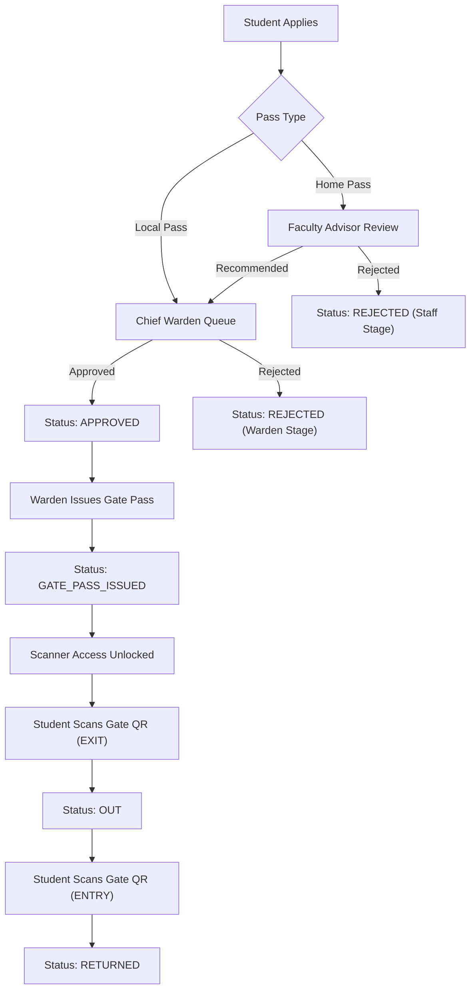

# DMI College Hostel Management PWA — Consolidated Technical Project Notes

This document is the unified technical reference for the DMI College Hostel Management Progressive Web Application (PWA). It consolidates all technical specifications, database designs, security protocols, API contracts, workflow lifecycles, and role access matrices.

---

## 1. System Architecture & Tech Stack

```
┌────────────────────────────────────────────────────────────────────────┐
│                        Next.js App Router (PWA)                        │
│   • React 19 • Tailwind CSS 4 • Framer Motion • Lucide Icons • Sonner   │
└───────────────────────────────────┬────────────────────────────────────┘
                                    │
┌───────────────────────────────────▼────────────────────────────────────┐
│                    Service-Layer & State Management                     │
│    • TanStack Query v5 (Persisted Cache) • React Hook Form + Zod       │
│    • PassService • GateService • StudentService • StaffService         │
└───────────────────────────────────┬────────────────────────────────────┘
                                    │
┌───────────────────────────────────▼────────────────────────────────────┐
│                  Backend API & Database Persistence                     │
│   • Next.js Route Handlers (/api/*) • MySQL2 / PostgreSQL Adapters      │
│   • HMAC-SHA256 Gate QR Verification • Row Level Security (RLS) Model   │
└────────────────────────────────────────────────────────────────────────┘
```

- **Runtime & Package Manager**: Bun (`bun@1.4.4`)
- **Framework**: Next.js 16.4.6 (App Router, Turbopack)
- **UI & Styling**: React 19.3.0, Tailwind CSS 4.3.3, `class-variance-authority`, `sonner`
- **Client Cache**: `@tanstack/react-query` v5 with synchronous local storage persister
- **Form Management**: `react-hook-form` v7 with `@hookform/resolvers/zod`
- **QR Operations**: `html5-qrcode` (camera scanner) and `qrcode.react` (poster renderer)
- **Database Client**: `mysql2` and standard SQL schema (`scripts/schema.sql`, `init-db.js`)

---

## 2. Database Schema Specification

The database model covers resident students, staff profiles, institutional oversight accounts, room allocations, gate passes, gate scan events, and permission letters:

```sql
-- 1. Enums
CREATE TYPE user_role AS ENUM ('student', 'warden', 'staff', 'hod', 'principal', 'correspondent');
CREATE TYPE pass_type AS ENUM ('Local Pass', 'Home Pass');
CREATE TYPE pass_status AS ENUM (
  'pending', 'recommended', 'approved', 'gate_pass_issued',
  'out', 'returned', 'overdue', 'rejected', 'cancelled'
);
CREATE TYPE account_status AS ENUM ('Active', 'Password change pending', 'Disabled');
CREATE TYPE recommendation_verdict AS ENUM ('recommend', 'do_not_recommend');

-- 2. Users Table (Auth Base)
CREATE TABLE users (
  id UUID PRIMARY KEY DEFAULT gen_random_uuid(),
  email VARCHAR(255) UNIQUE NOT NULL,
  encrypted_password VARCHAR(255) NOT NULL,
  role user_role NOT NULL,
  name VARCHAR(100) NOT NULL,
  phone VARCHAR(20),
  avatar_url TEXT,
  must_change_password BOOLEAN DEFAULT false,
  status account_status DEFAULT 'Active',
  disable_reason TEXT,
  created_at TIMESTAMPTZ DEFAULT now(),
  updated_at TIMESTAMPTZ DEFAULT now()
);

-- 3. Staff Profiles Table
CREATE TABLE staff_profiles (
  user_id UUID PRIMARY KEY REFERENCES users(id) ON DELETE CASCADE,
  department VARCHAR(10) NOT NULL,
  designation VARCHAR(100) NOT NULL,
  assigned_years INTEGER[] DEFAULT '{}',
  created_at TIMESTAMPTZ DEFAULT now()
);

-- 4. Rooms Table
CREATE TABLE rooms (
  room_number VARCHAR(10) PRIMARY KEY, -- 'G01'-'G30', '201'-'230', '301'-'330', '401'-'430'
  floor VARCHAR(5) NOT NULL,          -- 'GF', 'F2', 'F3', 'F4'
  capacity INTEGER DEFAULT 4,
  occupied INTEGER DEFAULT 0,
  status VARCHAR(20) DEFAULT 'available' -- 'available', 'partial', 'full', 'maintenance'
);

-- 5. Students Table
CREATE TABLE students (
  id UUID PRIMARY KEY REFERENCES users(id) ON DELETE CASCADE,
  student_id VARCHAR(20) UNIQUE NOT NULL, -- e.g. 'CSE-3-001'
  reg_no VARCHAR(20) UNIQUE NOT NULL,     -- e.g. '310621104001'
  name VARCHAR(100) NOT NULL,
  department VARCHAR(10) NOT NULL,
  programme VARCHAR(20) NOT NULL,
  year INTEGER NOT NULL CHECK (year BETWEEN 1 AND 4),
  batch VARCHAR(15) NOT NULL,             -- e.g. '2023-2027'
  floor VARCHAR(5) NOT NULL,
  room_number VARCHAR(10) REFERENCES rooms(room_number),
  room_verified BOOLEAN DEFAULT false,
  phone VARCHAR(20),
  dob DATE,
  blood_group VARCHAR(5),
  address TEXT,
  father_name VARCHAR(100),
  father_phone VARCHAR(20),
  mother_name VARCHAR(100),
  mother_phone VARCHAR(20),
  guardian_name VARCHAR(100),
  guardian_phone VARCHAR(20),
  created_at TIMESTAMPTZ DEFAULT now(),
  updated_at TIMESTAMPTZ DEFAULT now()
);

-- 6. Outpasses Table
CREATE TABLE passes (
  id UUID PRIMARY KEY DEFAULT gen_random_uuid(),
  pass_number VARCHAR(30) UNIQUE NOT NULL, -- e.g. 'DMI-202611-0001'
  student_id UUID NOT NULL REFERENCES students(id) ON DELETE CASCADE,
  type pass_type NOT NULL,
  reason TEXT NOT NULL,
  purpose VARCHAR(50),
  departure_time TIMESTAMPTZ NOT NULL,
  expected_return_time TIMESTAMPTZ NOT NULL,
  status pass_status DEFAULT 'pending',
  staff_recommendation recommendation_verdict,
  staff_remarks TEXT,
  staff_recommended_by UUID REFERENCES users(id),
  staff_recommended_at TIMESTAMPTZ,
  warden_approved_by UUID REFERENCES users(id),
  warden_approved_at TIMESTAMPTZ,
  warden_remarks TEXT,
  rejection_stage VARCHAR(20),
  rejection_reason TEXT,
  rejected_by UUID REFERENCES users(id),
  rejected_at TIMESTAMPTZ,
  actual_exit_time TIMESTAMPTZ,
  actual_return_time TIMESTAMPTZ,
  is_late BOOLEAN DEFAULT false,
  late_minutes INTEGER DEFAULT 0,
  created_at TIMESTAMPTZ DEFAULT now(),
  updated_at TIMESTAMPTZ DEFAULT now()
);

-- 7. Gate Scans Table
CREATE TABLE gate_scans (
  id UUID PRIMARY KEY DEFAULT gen_random_uuid(),
  pass_id UUID REFERENCES passes(id) ON DELETE CASCADE,
  student_id UUID REFERENCES students(id) ON DELETE CASCADE,
  scan_type VARCHAR(10) NOT NULL, -- 'EXIT' or 'ENTRY'
  gate_id VARCHAR(50) NOT NULL,   -- 'MAIN'
  gate_name VARCHAR(100) NOT NULL,
  scanned_at TIMESTAMPTZ DEFAULT now(),
  verified_by_geofence BOOLEAN DEFAULT false,
  distance_meters NUMERIC(6,2),
  is_fallback_code BOOLEAN DEFAULT false,
  raw_payload TEXT
);
```

---

## 3. Role & Permission Access Matrix

The application strictly enforces role-based access control (RBAC) across 6 discrete roles:

| Capability / Route | Student | Staff (Advisor) | HOD | Chief Warden | Principal | Correspondent |
| :--- | :---: | :---: | :---: | :---: | :---: | :---: |
| **Apply for Outpass** | ✅ Yes | ❌ | ❌ | ❌ | ❌ | ❌ |
| **Scan Gate QR (Camera)** | ✅ Yes | ❌ | ❌ | ❌ | ❌ | ❌ |
| **View Own Passes & Profile**| ✅ Yes | ❌ | ❌ | ❌ | ❌ | ❌ |
| **Advisory Recommendation** | ❌ | ✅ Dept Years | ✅ Entire Dept | ❌ | ❌ | ❌ |
| **Final Pass Approval** | ❌ | ❌ | ❌ | ✅ **Sole Approver** | ❌ | ❌ |
| **Issue Gate Pass** | ❌ | ❌ | ❌ | ✅ Yes | ❌ | ❌ |
| **Manage Gate QR Posters** | ❌ | ❌ | ❌ | ✅ Yes | ❌ | ❌ |
| **Staff Account Management** | ❌ | ❌ | ❌ | ✅ Yes | ❌ | ❌ |
| **Room Allocation** | ❌ | ❌ | ❌ | ✅ Yes | ❌ | ❌ |
| **Department Analytics** | ❌ | ❌ | ✅ Yes | ❌ | ✅ Campus | ✅ Campus |
| **Executive Security Audit**| ❌ | ❌ | ❌ | ✅ Yes | ✅ Yes | ✅ Yes |

---

## 4. Two-Tier Outpass Approval Workflow



### Business Rules
1. **Local Pass**: Bypasses department staff and routes directly to the Chief Warden.
2. **Home Pass**: First requires recommendation by the department Class In-Charge/Advisor. Once recommended, it enters the Chief Warden's approval queue.
3. **Sole Authority**: Only the **Chief Warden** has authorization to grant final approval and issue Gate Passes.
4. **Scanner Unlock**: Camera access on the student's device remains strictly locked until the pass achieves `GATE_PASS_ISSUED` status.

---

## 5. Fixed-Poster Gate QR Security Protocol

To eliminate display fraud, screenshot sharing, and proxy check-ins, the gate uses a **Fixed-Poster Paradigm**:

```
DMIGATE1|<gateId>|<dateKey>|<nonce>|<signature>
```

- **Header (`DMIGATE1`)**: Protocol identifier version 1.
- **Gate ID (`MAIN`)**: Campus checkpoint identifier.
- **Date Key (`YYYYMMDD`)**: Changes deterministically every 24 hours at midnight.
- **Daily Nonce (`k3x9ab`)**: 6-character human-readable fallback code displayed beneath the QR.
- **HMAC Signature (`5E8A9C`)**: Cryptographic signature generated server-side with `GATE_QR_SECRET_KEY`.

### Scan Verification Checks:
1. **Cryptographic Integrity**: Signature verified using HMAC-SHA256.
2. **Geofence Enforcement**: Student's GPS coordinates must fall within 150m radius of Main Gate (`lat: 12.845, lng: 79.95`).
3. **Anti-Double-Scan Filter**: Rejects scans for the same pass within a 30-second deduplication window.
4. **Active Clock Proof**: Exit and Entry screens display a live, ticking security verification clock with date and time to prevent video/screenshot replay.

---

## 6. Pre-Configured Test Credentials

| Portal / Role | Name | Identifier / Email | Password | Scope & Notes |
| :--- | :--- | :--- | :--- | :--- |
| **Student** | Rahul Kumar | `CSE-3-001` | `Student@123` | CSE Year 3, Room 304. Fully configured test profile. |
| **Chief Warden** | Dr. John Xavier | `warden.dmi@gmail.com` | `Warden@123` | Final approver for all passes, gate QR, and staff accounts. |
| **Faculty Advisor** | Prof. Rajesh Sharma | `staff.cse1@gmail.com` | `Staff@123` | CSE Faculty Advisor (Years 3 & 4). Advisory recommendations. |
| **HOD** | Dr. K. Arulmozhi | `hod.cse@gmail.com` | `Staff@123` | Head of Department (CSE). Department directory and attendance. |
| **Principal** | Dr. M. Senthil Kumar | `principal.dmi@gmail.com` | `Staff@123` | Campus overview, security log audits, executive oversight. |
| **Correspondent** | Rev. Fr. J. Antony | `correspondent.dmi@gmail.com` | `Staff@123` | Institutional management and governance reports. |

---

## 7. Service-Layer API Contracts

- **`passService`**:
  - `getStudentPasses(studentId)`: Fetches student's outpass history.
  - `getMyActivePass(studentId)`: Retrieves current active/pending pass.
  - `applyPass(payload)`: Validates and creates a new outpass request.
  - `getScannerEligibility(studentId, passId)`: Evaluates 7 workflow states and returns `{ canAccess: boolean, state: string }`.
  - `recommendPass(passId, verdict, remarks)`: Faculty advisor review.
  - `approvePass(passId, remarks)`: Warden approval.
  - `issueGatePass(passId)`: Warden issuance of gate pass.
  - `rejectPass(passId, stage, reason)`: Rejection at staff or warden stage.
- **`gateService`**:
  - `processScan({ studentId, qrText, location, source })`: Verifies gate QR and records `EXIT` or `ENTRY`.
  - `getActiveGateQr(gateId)`: Generates current dateKey QR payload and 6-char fallback code.
  - `getGateLogs(limit)`: Retrieves gate security activity history.

---

## 8. Deployment & Operational Notes

- **PWA Service Worker**: Cached shell assets and offline fallback page (`/offline`).
- **Responsive Layout**: Designed for mobile-first operation (`360×800`, `393×852`), tablet (`768×1024`), and desktop (`1366×768`).
- **Build Verification**: Compile with `bun run build` with zero TypeScript or route resolution errors.
