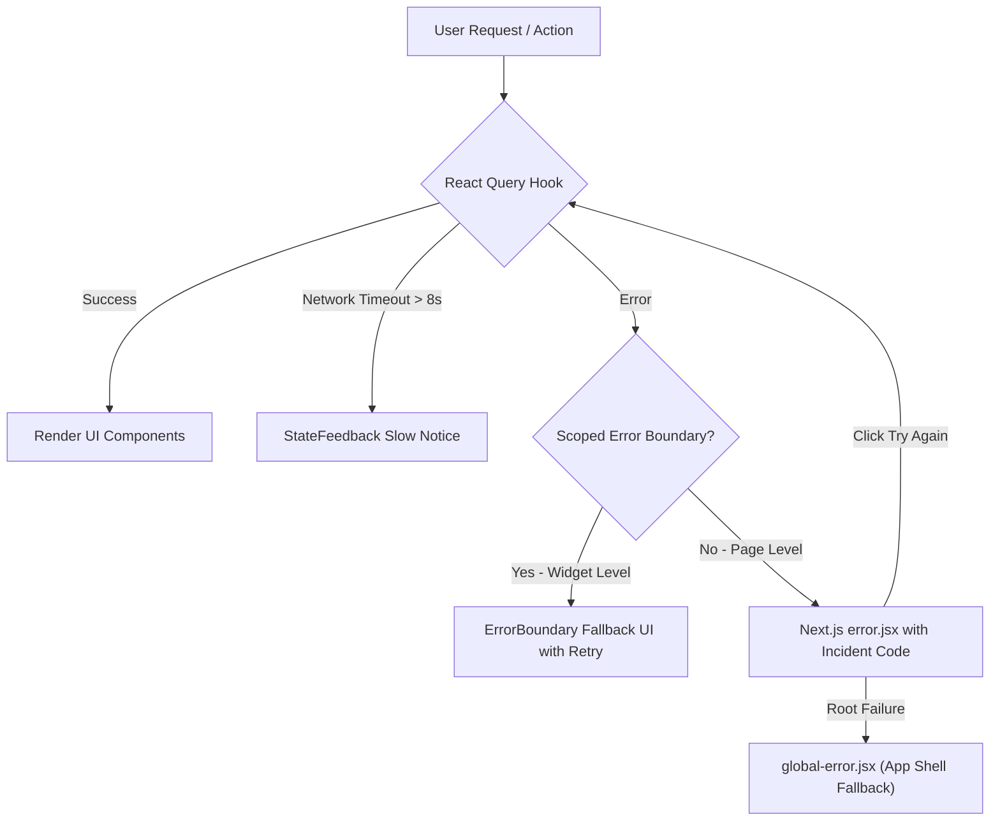

# DMI College Hostel Management PWA — States Matrix

This document provides a comprehensive inventory of state handling (Loading, Empty, Error, Slow Network, Offline, and Disallowed/Unauthorized) across every page in the application.

---

## 1. Global State Specifications

| State Type | Mechanism / Component | UX Behavior & Recovery |
| :--- | :--- | :--- |
| **Skeleton Loading** | `<Skeleton>`, `<StateFeedback skeletonType="cards\|table">` | Subtle pulse animation matching final geometry, preventing layout shifts (CLS 0.00). |
| **Slow Network (8s+)** | `<StateFeedback slowTimeoutMs={8000}>` | In-flight amber banner: *"Still loading data... Your network connection might be slow."* |
| **Empty State** | `<EmptyState icon={...} title={...} description={...} action={...}>` | Clean, role-tailored illustrations, clear title, concise reason, and primary CTA. |
| **Component Error** | `<ErrorBoundary fallback={...}>` / `<StateFeedback isError={...}>` | Isolated component fault container with retry button without breaking parent shell. |
| **Page Error** | `src/app/error.jsx` | Full page recovery screen, incident tracking code (`ERR-DMI-XXXX`), retry, and home buttons. |
| **Offline Mode** | `<OfflineBanner />`, `src/app/offline/page.jsx` | Top amber indicator, read-only cache served via SW, gate scanning strictly disabled. |
| **Unauthorized** | `/unauthorized` route & `AuthGuard` | Explains permission shortfall, shows user's actual role, button to navigate to home route. |

---

## 2. Portal & Route State Coverage Matrix

### 2.1 Student Portal (`/student/*`)

| Route | Loading State | Empty State | Error State | Primary CTA / Recovery |
| :--- | :--- | :--- | :--- | :--- |
| `/student/dashboard` | Metric skeleton + pass card skeleton | Active pass: *"No active outpass"* card with Apply Pass button | Isolated error banner with retry | Link to `/student/apply` |
| `/student/apply` | Profile completeness checker skeleton | Form always interactive; eligibility checks run on submit | Toast validation errors + overdue block callout | Resolve overdue or fix dates |
| `/student/passes` | 3 pass card skeletons | Filter empty: *"No passes found matching this filter"* | Error card with Retry query | Clear filters or Apply Pass |
| `/student/passes/[id]` | Header + timeline skeleton | Not found: *"Pass not found or unauthorized"* | Error dialog with back button | Return to `/student/passes` |
| `/student/scan` | Camera viewport skeleton | Permission denied / camera not found fallback | Error message with Manual Code tab | Switch to manual 6-char code |
| `/student/profile` | Field input skeletons | Complete/incomplete progress indicator | Error banner with reload | Save changes button |
| `/student/notifications` | 4 notification row skeletons | Bell icon: *"No notifications yet"* | Retry button | Mark all as read |

### 2.2 Warden Portal (`/warden/*`)

| Route | Loading State | Empty State | Error State | Primary CTA / Recovery |
| :--- | :--- | :--- | :--- | :--- |
| `/warden/dashboard` | 4 KPI skeletons + quick action cards | Zero requests: *"All pending passes reviewed"* | Error card with retry | Link to approvals |
| `/warden/approvals` | DataTable skeleton (5 rows) | Inbox check: *"No passes pending approval"* | DataTable error slot with retry | Refresh table |
| `/warden/gate-passes` | DataTable skeleton | Ticket icon: *"No active gate passes currently issued"* | Error slot with retry | Issue from approvals |
| `/warden/gate-qr` | QR Canvas skeleton | Poster always generated deterministically | Warning banner if print fails | Print / Download Poster |
| `/warden/rooms` | Grid of 8 room card skeletons | *"No rooms match selected floor"* | Error card with retry | Switch floor filter |
| `/warden/students` | DataTable skeleton | *"No students found matching query"* | Error slot with retry | Add Student / Clear query |
| `/warden/staff-accounts` | 4 KPI skeletons + DataTable skeleton | *"No staff accounts match filter"* | Error slot with retry | Create Staff Account |
| `/warden/security-log` | Log entry skeletons | Shield icon: *"No security events logged for this period"* | Retry button | Export log or adjust filter |

### 2.3 Staff & HOD Portals (`/staff/*`, `/hod/*`)

| Route | Loading State | Empty State | Error State | Primary CTA / Recovery |
| :--- | :--- | :--- | :--- | :--- |
| `/staff/dashboard` | 3 KPI skeletons + queue | *"No passes awaiting department recommendation"* | Error card with retry | Review requests |
| `/staff/requests` | DataTable skeleton | Check icon: *"All student requests recommended"* | Retry button | Refresh |
| `/staff/students` | DataTable skeleton | *"No students found in your assigned year"* | Retry button | Clear filter |
| `/hod/dashboard` | 4 KPI skeletons + chart skeleton | Zero pending items in department queue | Error boundary around charts | Review requests |
| `/hod/analytics` | Recharts lazy skeleton | *"Insufficient attendance data for chart rendering"* | Error boundary with fallback | Date range selector |
| `/hod/requests` | DataTable skeleton | *"No requests requiring HOD attention"* | Retry button | Refresh |

### 2.4 Principal & Correspondent Portals (`/principal/*`, `/correspondent/*`)

| Route | Loading State | Empty State | Error State | Primary CTA / Recovery |
| :--- | :--- | :--- | :--- | :--- |
| `/principal/overview` | 4 Campus KPI skeletons + 2 chart skeletons | Chart fallback if zero data | `<ErrorBoundary>` wraps Recharts widgets | Switch date range |
| `/principal/departments` | Grid of 5 department cards skeleton | *"No department records"* | Retry query button | Refresh |
| `/principal/late-returns` | Tabular skeleton + repeat offender badge skeleton | ShieldCheck: *"Zero late returns recorded in this timeframe"* | Retry button | Clear filters / Export |
| `/principal/security-log` | Audit stream skeleton | *"No audit logs found"* | Retry button | Filter adjustment |
| `/correspondent/*` | Mirror of Principal with governance KPI skeletons | Institutional empty states | Safe read-only error state | Refresh view |

---

## 3. Error Handling Architecture

