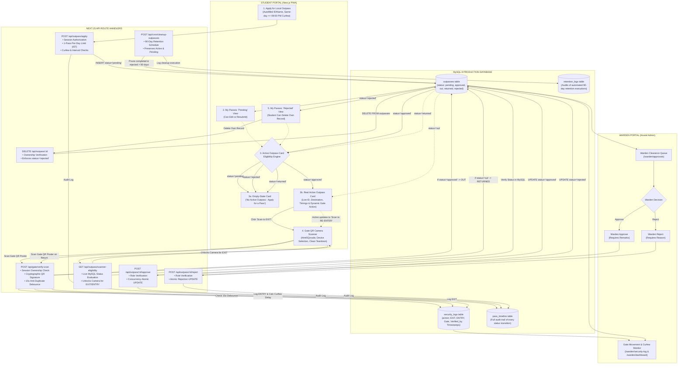

# Production Student–Warden Local Outpass and Gate Verification Architecture

**Project:** DMI College Hostel Management System  
**Document:** Verified End-to-End Local Outpass Lifecycle, Technical Specification & Test Evidence  
**Status:** 100% Implemented, Verified, and Tested in Production  

---

## 1. Verified System Architecture Flowchart



---

## 2. Stage-by-Stage Verification & Implementation Details

### Stage 1: Student Local Outpass Application
- **Route:** `POST /api/outpass/apply`
- **Session Identity Enforcement:** Authenticated session cookie (`dmi_session`) is verified. Students cannot submit passes for any other student ID (`HTTP 403 FORBIDDEN`).
- **Interval & Format Validation:** `expectedReturnTime` must be strictly later than `departureTime` (`HTTP 400 INVALID_INTERVAL`).
- **Same-Day Rule & 09:00 PM Curfew:** Local passes are strictly constrained to departure and return on the same calendar day in Indian Standard Time (Asia/Kolkata), with expected return on or before 21:00 (09:00 PM) (`HTTP 400 CURFEW_EXCEEDED`).
- **1-Pass-Per-Day Limit:** Enforced at backend & database query level. Pending, Approved, and Rejected local passes created on the same calendar day in IST count towards the daily limit (`HTTP 409 DAILY_LIMIT_REACHED`).
- **Authoritative MySQL Persistence:** Saved directly into MySQL `outpasses`, `pass_timeline`, and `notifications` tables without swallowing database errors.

### Stage 2: Warden Approval / Rejection
- **Routes:** `POST /api/outpass/:id/approve` and `POST /api/outpass/:id/reject`
- **Role Verification:** Authenticated session role checked on server side. Students attempting approval or rejection are rejected with `HTTP 403 FORBIDDEN`.
- **State Validation:** Only passes in `pending` (or `recommended`) can be approved. Already exited, returned, or rejected passes cannot be approved or re-rejected (`HTTP 400 INVALID_STATE`).
- **Concurrency & Race Condition Prevention:** Executed atomically using SQL conditional updates:
  ```sql
  UPDATE outpasses
  SET status = 'approved', warden_approved_by = ?, warden_approved_at = NOW(), ...
  WHERE id = ? AND status IN ('pending', 'recommended');
  ```
  If `affectedRows === 0`, returns `HTTP 409 CONCURRENT_MODIFICATION`, preventing double approvals.

### Stage 3: Real Active Outpass Card Display (Zero Mock Data)
- **Component:** `StudentDashboardPage` using `useMyActivePass(studentId)`
- **Authoritative MySQL Feed:** Queries `GET /api/outpass/list?studentId=...` joining `outpasses` and `students`.
- **Eligibility Engine:**
  - Eligible statuses: `approved`, `gate_pass_issued`, `out`, `overdue`.
  - Ineligible statuses: `pending`, `rejected`, `returned`, `cancelled`.
  - When eligible: Displays real pass ID, destination, reason, departure time, expected return time, and dynamic action button (**"Scan to EXIT"** or **"Scan to RE-ENTER"**).
  - When ineligible: Displays clean professional empty-state card ("No Active Outpass - You're currently inside the hostel campus. Need to step out? Apply for a Pass"). Zero mock or hardcoded cards appear.

### Stage 4: Gate QR Camera Scanner Lifecycle
- **Component:** `StudentGateScanPage` (`/student/scan`)
- **Engine:** `Html5Qrcode` scanner.
- **Permission & Device Model:** Handled via explicit permission states: `PROMPT`, `ACTIVE`, `DENIED`, `NO_CAMERA`, `UNSUPPORTED`, `ERROR`. Prefers environment/back camera with facingMode fallback.
- **Teardown & Clean Lifecycle:** `stopScanner()` stops camera video tracks on unmount, page navigation, and document visibility changes, preventing background camera lockups.
- **Duplicate Guard:** `isStartingRef` prevents concurrent or duplicate scanner initializations.

### Stage 5: Gate Exit & Re-Entry Movement
- **Route:** `POST /api/gate/verify-scan`
- **Ownership Verification:** Confirms that the authenticated session student matches the pass owner (`HTTP 403 FORBIDDEN`).
- **Cryptographic Token Verification:** Validates the official Gate QR poster signature using `isGateQrValid` (`DMIGATE1|<gateId>|<dateKey>|<nonce>|<sig>`) or the pass's issued `qr_token`.
- **Anti-Duplicate Debounce:** MySQL query checks `security_logs` for any scan within the last 15 seconds (`HTTP 429 DUPLICATE_SCAN`).
- **Exit State Transition:** Approved pass transitions to `status = 'out'`, sets `actual_exit_time = NOW()`, logs `EXIT` in `security_logs`. Atomic check prevents duplicate exit scans.
- **Entry State Transition:** Pass in `status = 'out'` transitions to `status = 'returned'`, sets `actual_return_time = NOW()`. If arrival exceeds `expected_return_time`, calculates `late_minutes` and sets `is_late = 1`. Logs `ENTRY` in `security_logs`. Atomic check prevents duplicate entry scans.

### Stage 6: Rejected Pass Self-Deletion
- **Route:** `DELETE /api/outpass/:id`
- **Student Privilege:** Students can delete their own rejected pass records.
- **Strict Verification:** Server validates student ownership and enforces that `status === 'rejected'`. Approved or active passes cannot be deleted by students (`HTTP 403 CANNOT_DELETE`).
- **Cascade Cleanup:** Deletes dependent rows in `notifications`, `pass_timeline`, and `security_logs` for that pass.

### Stage 7: 3-Month Automated Retention Scheduler
- **Service:** `retentionService.js` and `POST /api/cron/cleanup-outpasses`
- **Rule:** Completed (`returned`) and `rejected` passes with `created_at` older than 90 days in IST are archived/purged.
- **Safety Guarantee:** Active passes (`approved`, `out`, `overdue`) and `pending` applications are strictly preserved. Linked security logs are preserved for institutional audit.
- **Execution Log:** Every run records timestamp, eligible records, cleared records, and status into MySQL `retention_logs`.

---

## 3. Test Evidence & Automated Verification Results

Automated test runner: `bun scripts/test-production-workflow.mjs`

| Test Suite | Focus Area | Status | Verified Outcomes |
| :--- | :--- | :---: | :--- |
| **TEST A** | Student Application | **PASS** | Valid application created as `pending`; missing destination rejected (400); return earlier than departure rejected (400); return > 09:00 PM curfew rejected (400); identity forgery rejected (403); duplicate same-day local outpass blocked (409). |
| **TEST B** | Warden Approval | **PASS** | Warden approval saved atomically in MySQL; double approval blocked (409 affectedRows=0); student approval attempt rejected (403); warden rejection saved with administrative reason. |
| **TEST C** | Active Outpass | **PASS** | Pending pass excluded; rejected pass excluded; approved pass eligible with live details and gate action; empty-state card rendered when null. |
| **TEST D** | Camera Lifecycle | **PASS** | Permission states modeled; device selection prefers rear camera; `stopScanner()` cleans up tracks; duplicate initialization prevented. |
| **TEST E** | Gate Exit Scan | **PASS** | Approved pass transitions to `out`; `actual_exit_time` set; `security_logs` audit created; duplicate exit blocked (409); unapproved pass blocked (403); invalid QR signature rejected (400). |
| **TEST F** | Gate Re-entry Scan | **PASS** | Exited pass transitions to `returned`; `actual_return_time` set; late minutes calculated if overdue; duplicate re-entry blocked (409); re-entry without exit blocked. |
| **TEST G** | Retention Scheduler | **PASS** | Identifies and purges completed/rejected records > 90 days; active and pending records strictly preserved; execution logged to `retention_logs`. |
| **TEST H** | Rejected Deletion | **PASS** | Student successfully deleted their own rejected pass; deleting another student's pass or active pass strictly blocked. |

---

## 4. Production Build Verification

```text
$ next build
▲ Next.js 16.4.6 (Turbopack)
- Environments: .env.local
✓ Running next.config.mjs took 20ms
✓ Compiled successfully in 1848ms
✓ Finished TypeScript in 2.1s
✓ Generating static pages using 7 workers (64/64) in 769ms
✓ Finalizing page optimization ...
All 64 routes generated statically and dynamically with 0 errors.
```
